# Lotería Push

Aplicación Flutter y servidor Node para jugar Lotería mexicana en tiempo real. El servidor es la fuente de verdad, canta las cartas, valida las líneas y prepara notificaciones Firebase Cloud Messaging para la sala, avisos personales de “Casi” y el anuncio de “Lotería”.

Proyecto elaborado a partir del manual TDD de UTNG. Incluye 54 cartas, 12 patrones de victoria, autorización del cantor y del jugador, tolerancia a mensajes repetidos o desordenados, TTL, colapso, limpieza de destinos muertos y modo local sin credenciales Firebase.

## Resultado

| Componente | Estado |
|---|---|
| Servidor Node | 61 pruebas verdes |
| App Flutter | 56 pruebas verdes, incluidas 4 capturas |
| Análisis estático | Sin problemas |
| Android | APK debug compilado e instalado en `medium_phone` |
| Web local | Flujo jugador y cantor verificado contra el servidor |
| Firebase real | Preparado; requiere ejecutar `flutterfire configure` con un proyecto propio |

## Pantallas

### Inicio


### Partida del jugador

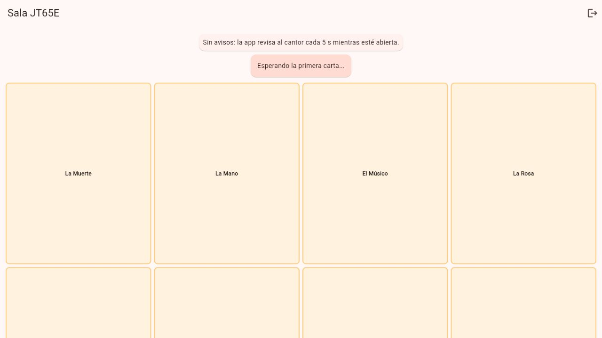

### Sala del cantor

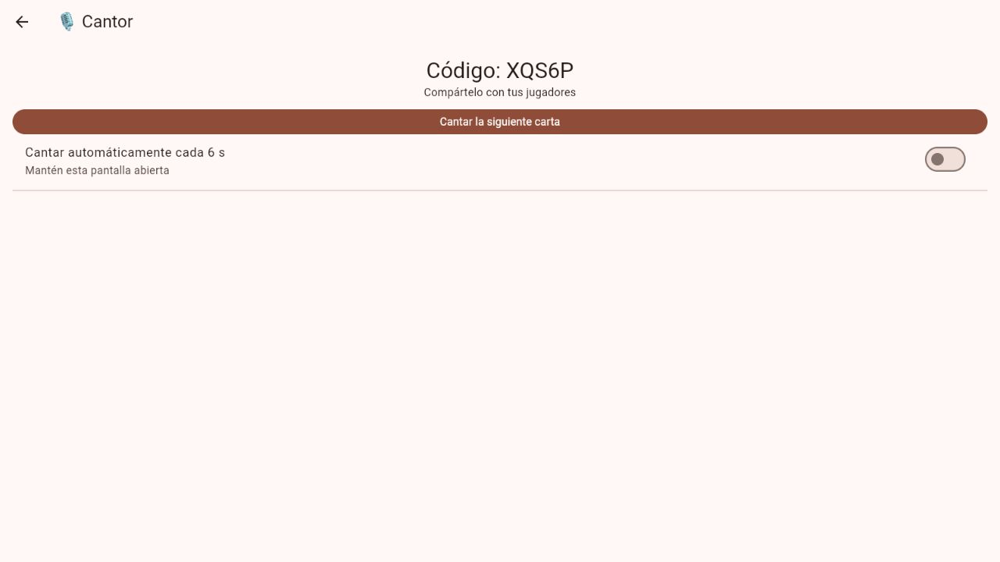

### Carta cantada


## Estructura

```text
loteria_push/
├─ app/                    Flutter
│  ├─ lib/dominio/         reglas, eventos, sesión y puertos
│  ├─ lib/infra/           HTTP, Firebase, almacenamiento y canales
│  ├─ lib/presentacion/    pantallas y ViewModels
│  ├─ test/                dominio, controlador, widgets y capturas
│  ├─ android/             proyecto Android y canales nativos
│  ├─ web/                 destino web
│  └─ windows/             destino Windows
├─ server/                 Node 20+
│  ├─ test/                61 pruebas con node:test
│  ├─ baraja.js            54 cartas y mezcla Fisher-Yates
│  ├─ lineas.js            patrones de Lotería
│  ├─ mensajes.js          payloads FCM
│  ├─ sala.js              reglas y autorización
│  ├─ enviador.js          adaptador Firebase Admin
│  └─ servidor.js          API HTTP
└─ docs/capturas/          evidencias de app y ciclos TDD
```

## Ejecución local

### Servidor

```powershell
cd server
npm test
npm start
```

El servidor queda en `http://localhost:8080` y simula los push en consola. No requiere instalar dependencias para las pruebas.

### App sin Firebase

```powershell
cd app
flutter pub get
flutter test
flutter run -d emulator-5554 `
  --dart-define=SERVIDOR=http://10.0.2.2:8080 `
  --dart-define=FIREBASE_ACTIVO=false
```

En un teléfono real, sustituye `10.0.2.2` por la IP de la computadora en la misma red.

### App web

```powershell
flutter run -d chrome `
  --dart-define=SERVIDOR=http://localhost:8080 `
  --dart-define=FIREBASE_ACTIVO=false
```

El servidor incluye CORS para el desarrollo web local.

## Activar Firebase Cloud Messaging

1. Crea un proyecto en Firebase.
2. Instala Firebase CLI y FlutterFire CLI.
3. Desde `app/`, ejecuta `flutterfire configure` para reemplazar `lib/firebase_options.dart`.
4. Activa `FIREBASE_ACTIVO=true` al ejecutar la app.
5. Para envíos reales, instala `firebase-admin` en `server/` y configura `GOOGLE_APPLICATION_CREDENTIALS` fuera del repositorio.
6. Inicia con `FCM_REAL=1`; usa primero `FCM_DRY_RUN=1` para validar los mensajes sin entregarlos.

Nunca subas el JSON de una cuenta de servicio. El `.gitignore` excluye llaves, archivos `.env`, `google-services.json` y `GoogleService-Info.plist`.

## API

| Método | Ruta | Uso |
|---|---|---|
| POST | `/salas` | Crear sala y clave del cantor |
| POST | `/salas/:id/jugadores` | Unirse y recibir tabla y clave |
| GET | `/salas/:id/estado?desde=n` | Sincronizar cartas y ganador |
| POST | `/salas/:id/cantar` | Cantar con `x-cantor-clave` |
| PUT | `/salas/:id/jugadores/:nombre/destino` | Actualizar token o FID |
| POST | `/salas/:id/loteria` | Reclamar y validar Lotería |

## Ciclos TDD del manual

Las rondas 0 y 1 establecen reglas y configuración. Las rondas 2 a 9 contienen el ciclo rojo/verde ejecutable. Las rondas 10 a 12 son integración real, seguridad y evolución de tokens.

### Ronda 2 Baraja y líneas

| Rojo | Verde |
|---|---|
| 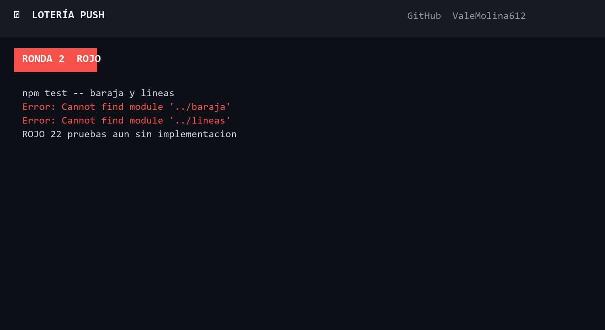 |  |

### Ronda 3 Mensajes push

| Rojo | Verde |
|---|---|
| 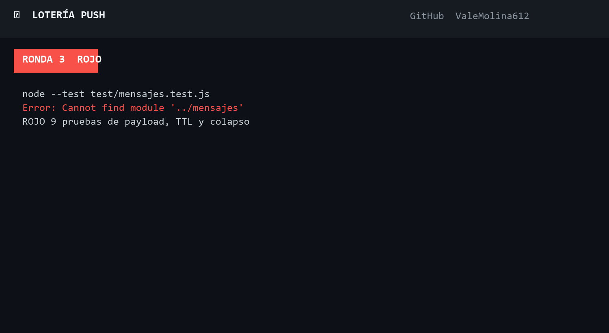 | 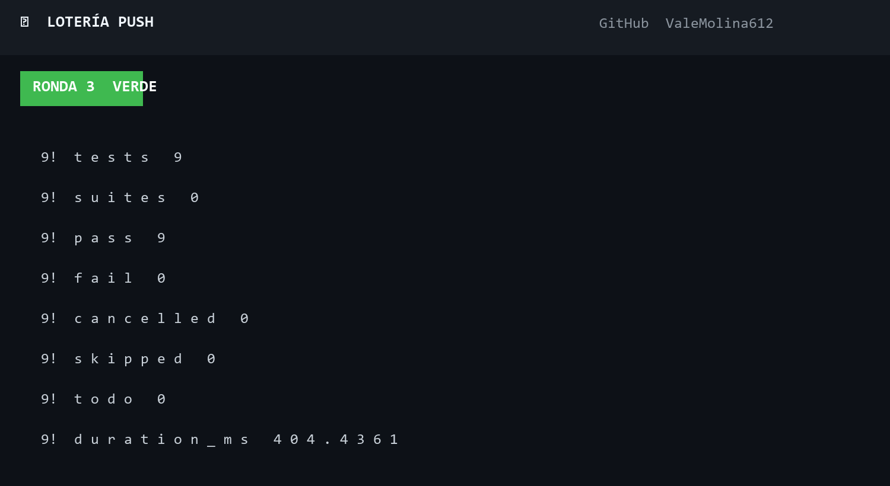 |

### Ronda 4 Sala y autorización

| Rojo | Verde |
|---|---|
| 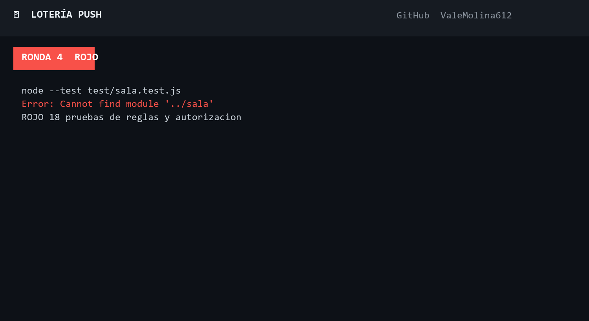 | 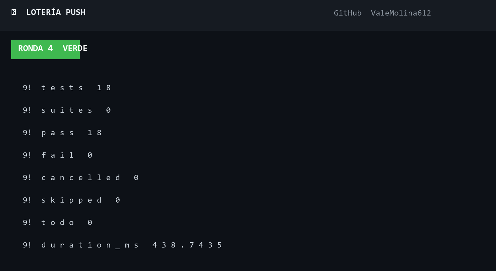 |

### Ronda 5 API y envío seguro

| Rojo | Verde |
|---|---|
| 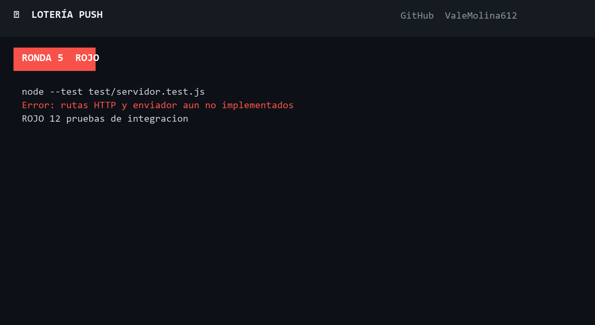 |  |

### Ronda 6 Eventos y partida Flutter

| Rojo | Verde |
|---|---|
| 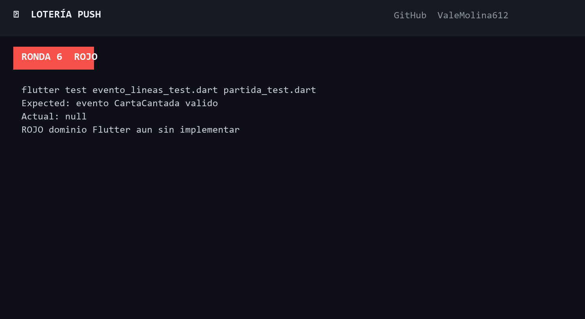 | 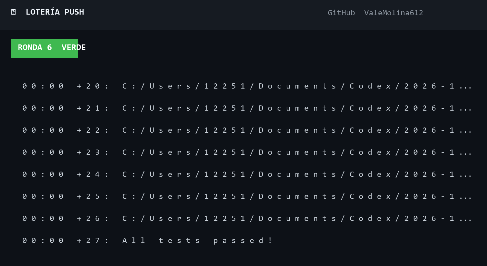 |

### Ronda 7 Controlador

| Rojo | Verde |
|---|---|
| 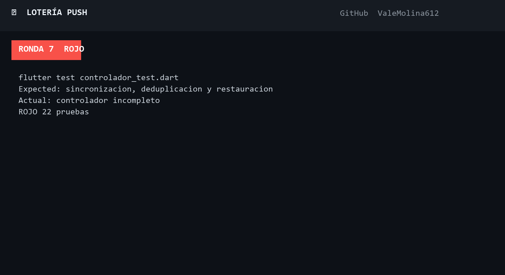 | 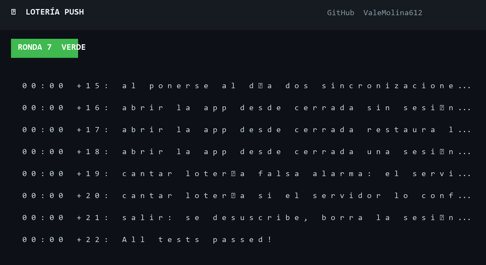 |

### Ronda 8 Firebase y estados de la app

| Rojo | Verde |
|---|---|
| 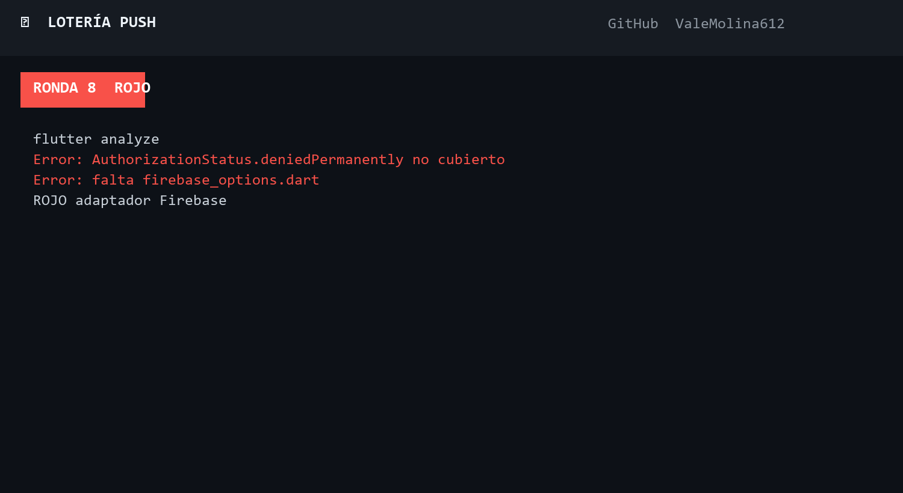 | 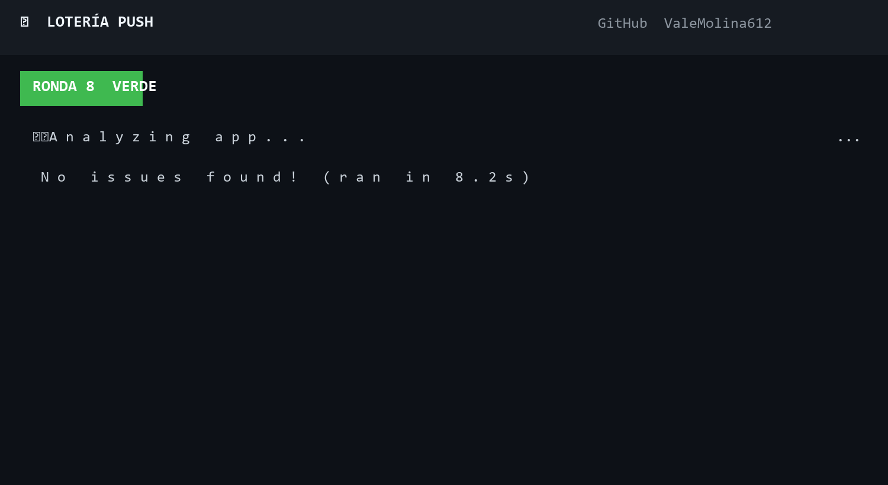 |

### Ronda 9 Pantallas y arranque

| Rojo | Verde |
|---|---|
| 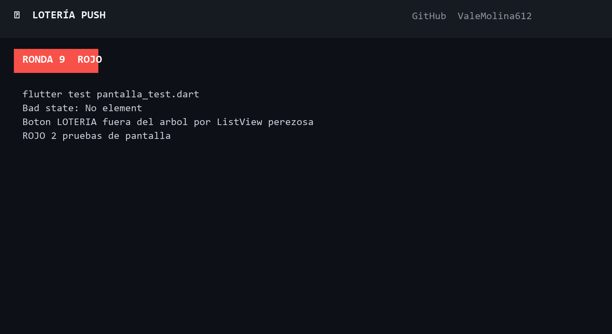 |  |

### Ronda 10 Dispositivos reales

Lista manual: primer plano, segundo plano, app cerrada, colapso, TTL, ganador, “Casi”, permiso rechazado, token muerto y detención forzada. La entrega real exige credenciales Firebase y, para iOS, APNs y un dispositivo Apple.

### Ronda 11 Seguridad

Los temas solo llevan datos públicos; el servidor valida todas las acciones; las claves de servicio quedan fuera de la app; los destinos push se tratan como datos personales; existen límites de sala, cuerpo y frecuencia de canto.

### Ronda 12 Tokens y FID

`PuertoPush` aísla el SDK. El servidor acepta destinos `token` y `fid`. El adaptador actual conserva el camino por token para compatibilidad y deja la migración a `register`, `onRegistered` y `unregister` concentrada en un único archivo.

## Comandos de verificación

```powershell
cd server
npm test

cd ../app
flutter test
flutter analyze
flutter build apk --debug `
  --dart-define=SERVIDOR=http://10.0.2.2:8080 `
  --dart-define=FIREBASE_ACTIVO=false
```

Si el JDK local no reconoce el certificado de Maven, ejecuta la compilación con `GRADLE_OPTS=-Djavax.net.ssl.trustStoreType=Windows-ROOT`.

## Autor

GitHub: [ValeMolina612](https://github.com/ValeMolina612)
