### Inicio

### Partida del jugador

### Sala del cantor

### Carta cantada

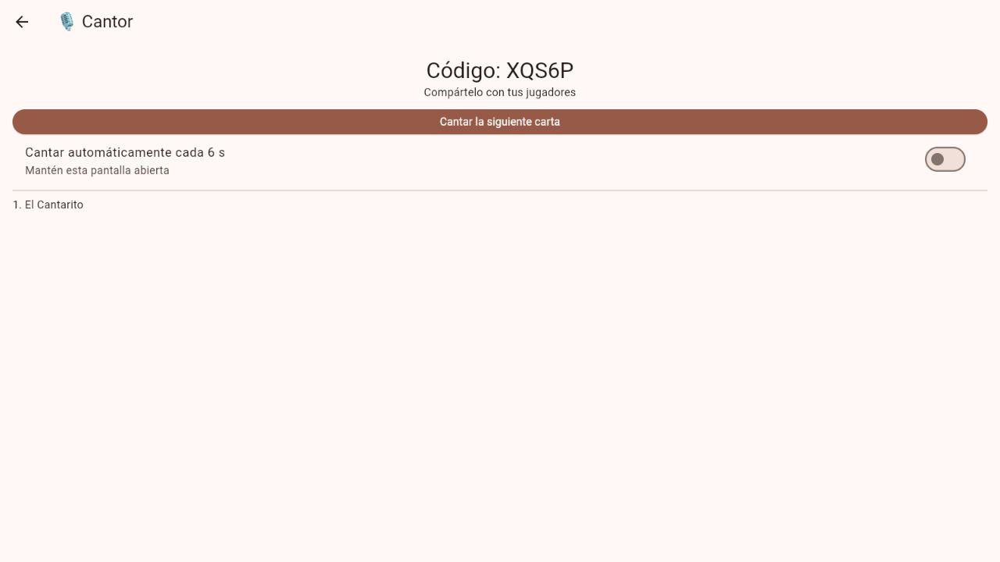

### Ronda 0 Reglas del juego

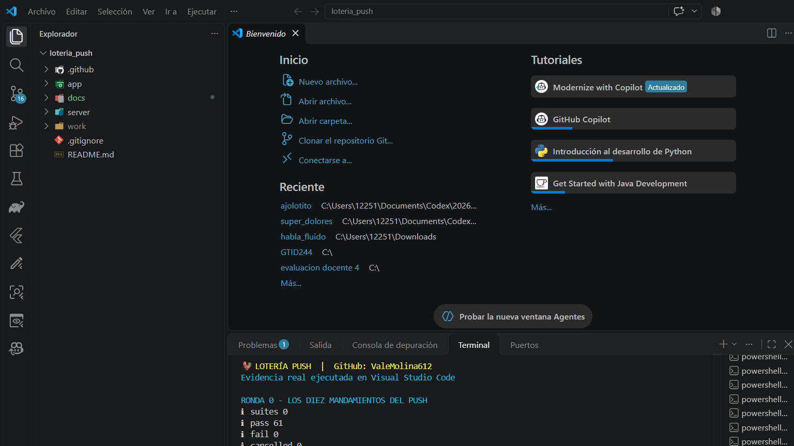

### Ronda 1 Preparación y configuración

### Ronda 2 Baraja y líneas

| Rojo | Verde |
|---|---|
| 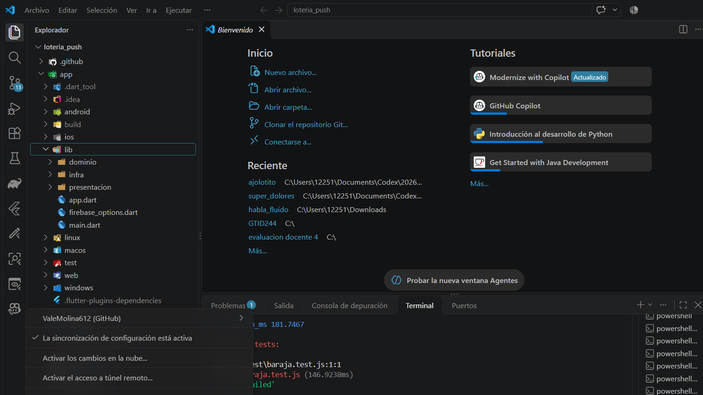 | 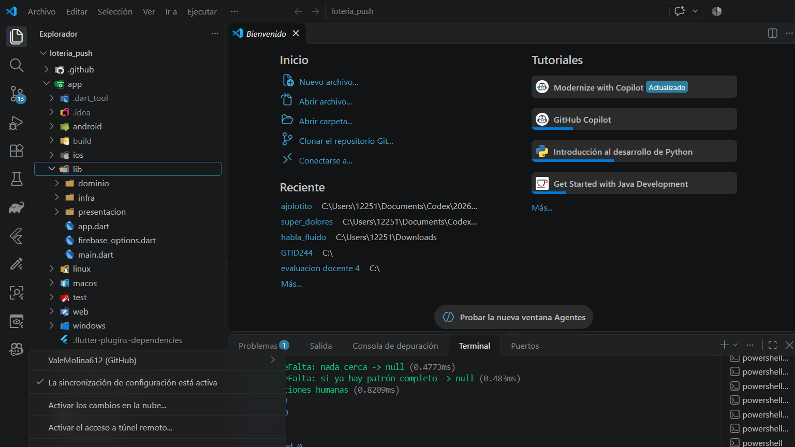 |

### Ronda 3 Mensajes push

| Rojo | Verde |
|---|---|
|  |  |

### Ronda 4 Sala y autorización

| Rojo | Verde |
|---|---|
|  | 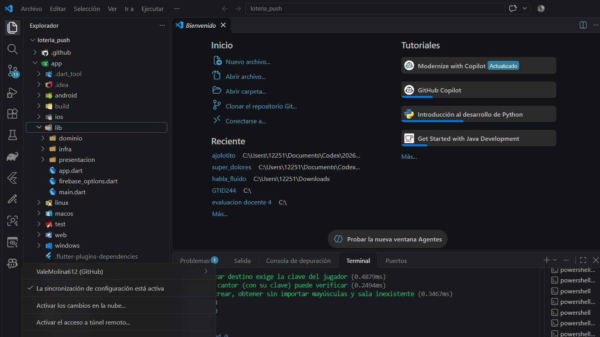 |

### Ronda 5 API y envío seguro

| Rojo | Verde |
|---|---|
|  |  |

### Ronda 6 Eventos y partida Flutter

| Rojo | Verde |
|---|---|
|  |  |

### Ronda 7 Controlador

| Rojo | Verde |
|---|---|
|  | 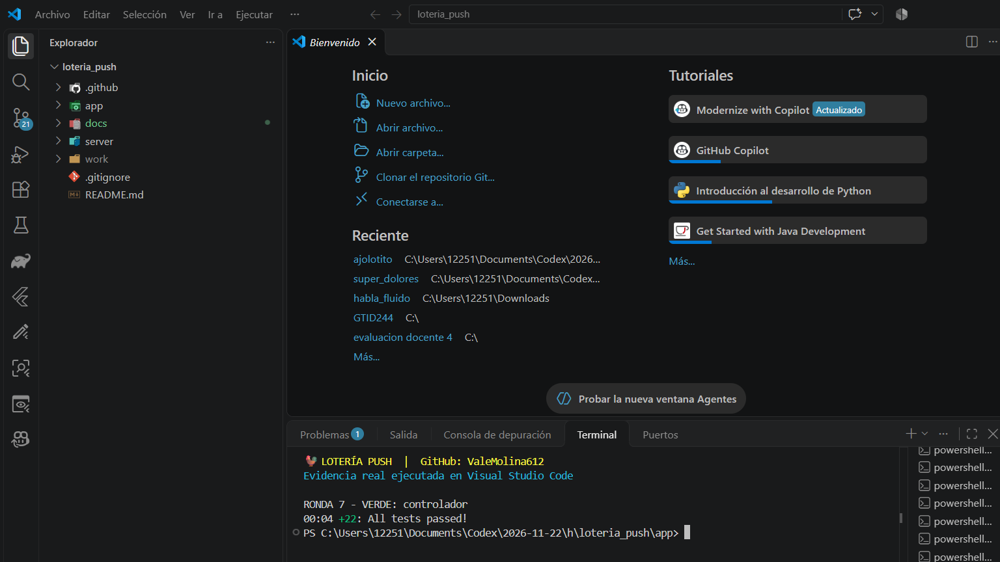 |

### Ronda 8 Firebase y estados de la app

| Rojo | Verde |
|---|---|
|  | 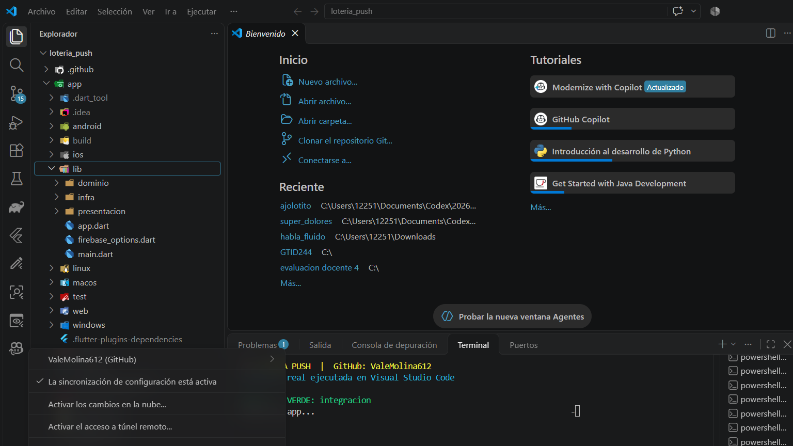 |

### Ronda 9 Pantallas y arranque

| Rojo | Verde |
|---|---|
| 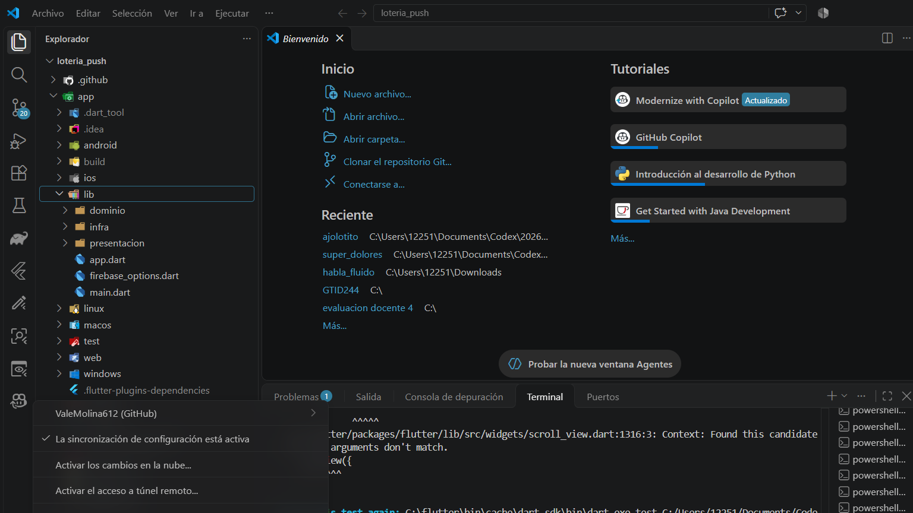 | 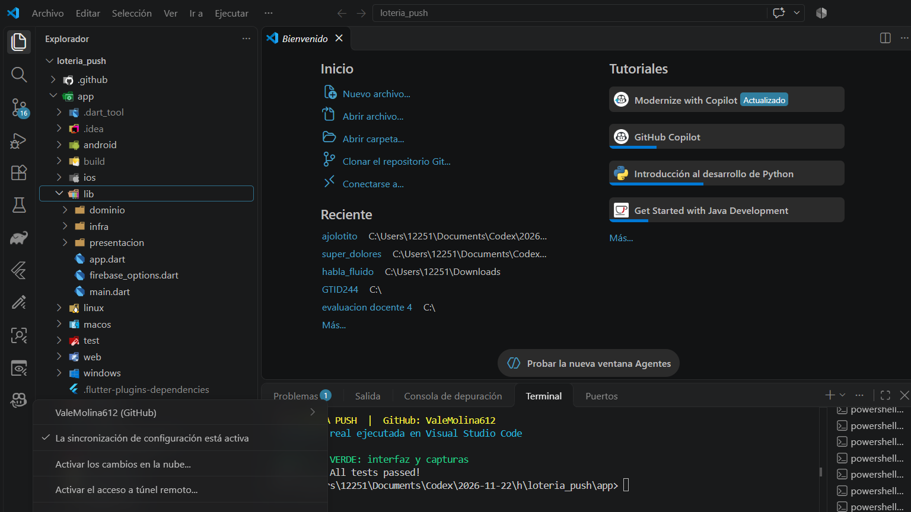 |

### Ronda 10 Dispositivos reales

Lista manual: primer plano, segundo plano, app cerrada, colapso, TTL, ganador, “Casi”, permiso rechazado, token muerto y detención forzada. La entrega real exige credenciales Firebase y, para iOS, APNs y un dispositivo Apple.

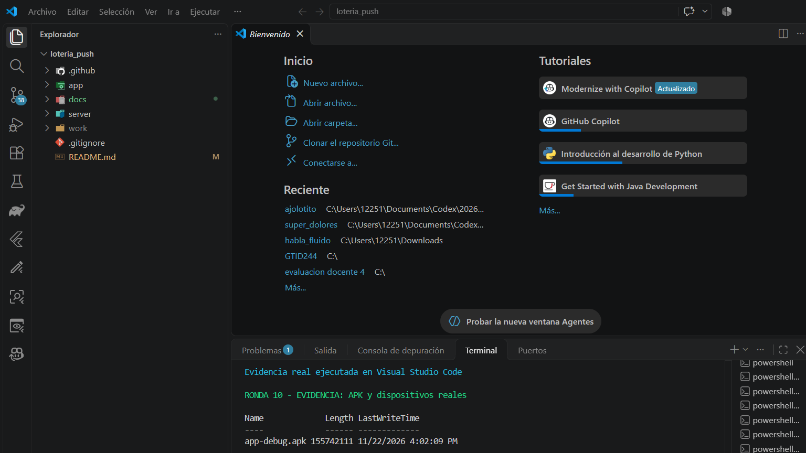

### Ronda 11 Seguridad

Los temas solo llevan datos públicos; el servidor valida todas las acciones; las claves de servicio quedan fuera de la app; los destinos push se tratan como datos personales; existen límites de sala, cuerpo y frecuencia de canto.

### Ronda 12 Tokens y FID

`PuertoPush` aísla el SDK. El servidor acepta destinos `token` y `fid`. El adaptador actual conserva el camino por token para compatibilidad y deja la migración a `register`, `onRegistered` y `unregister` concentrada en un único archivo.

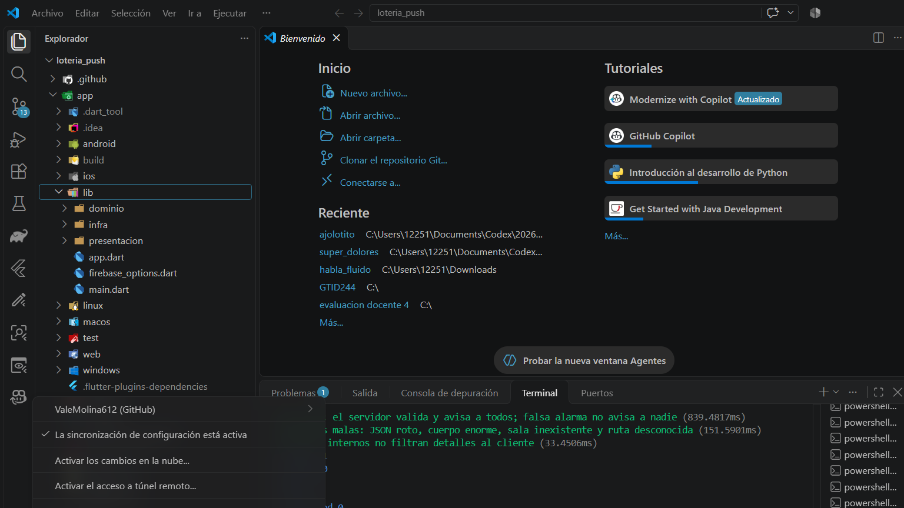

Si el JDK local no reconoce el certificado de Maven, ejecuta la compilación con `GRADLE_OPTS=-Djavax.net.ssl.trustStoreType=Windows-ROOT`.

## Autor

GitHub: [ValeMolina612](https://github.com/ValeMolina612)
